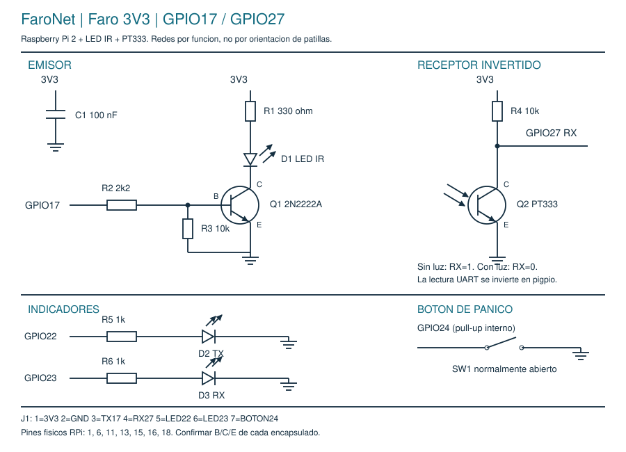

# Esquemático y conexiones del Faro actual

Versión de referencia: Raspberry Pi 2, 3,3 V, TX17/RX27 y PT333 con pull-up.
La numeración R1-R6 de este documento corresponde a esta revisión.



## Redes eléctricas

```text
EMISOR
3V3 -- R1 330 ohm -- anodo D1 LED IR catodo -- C de Q1 2N2222A
GPIO17 -- R2 2k2 --+-- B de Q1
                  |
                 R3 10k
                  |
GND --------------+-- E de Q1

RECEPTOR
3V3 -- R4 10k --+-- GPIO27 (RX)
               |
               C de Q2 PT333
               E
               |
GND -----------+

INDICADORES
GPIO22 -- R5 1k -- anodo D2 TX catodo -- GND
GPIO23 -- R6 1k -- anodo D3 RX catodo -- GND

PANICO Y DESACOPLO
GPIO24 -- SW1 normalmente abierto -- GND
3V3 --- C1 100 nF --- GND
```

R1 también puede estar entre el cátodo de D1 y el colector de Q1 si permanece en
la misma rama serie y no hay otra conexión en el punto intermedio. Es la
disposición equivalente usada en la guía de placa perforada. No unir el LED
directamente a la alimentación sin resistencia.

## Header desmontable

| Contacto J1 | Red | Pin físico Raspberry | BCM |
| --- | --- | --- | --- |
| 1 | 3V3 | 1 | - |
| 2 | GND | 6 | - |
| 3 | TX | 11 | 17 |
| 4 | RX | 13 | 27 |
| 5 | LED_TX | 15 | 22 |
| 6 | LED_RX | 16 | 23 |
| 7 | PANICO | 18 | 24 |

No confundir número BCM con posición física. No conectar el header de la placa
a los siete pines consecutivos de la Raspberry: cada cable va al pin indicado.
El botón usa pull-up interno y debe unir GPIO24 con GND al presionarse. En un
pulsador de cuatro patas, comprobar con continuidad cuáles ya están unidas.

## Polaridad y orientación

Q1 se conecta por función B/C/E, no por una regla universal de lado plano. El
patillaje depende del fabricante y encapsulado. Identificarlo con la referencia
de la pieza o prueba de diodo antes de soldar. En Q2 también se confirma C/E;
no generalizar longitud de pata o color a todos los fototransistores.

En oscuridad el colector de Q2 debe quedar cerca de 3,3 V. Con luz suficiente
debe bajar cerca de GND. Ese nivel se invierte dentro del lector pigpio. El
condensador C1 y el pull-up R4 no deben quedar sin conexión al riel de 3,3 V.

## Soldadura, revisión y fotografías

Cada unión de la protoboard se reproduce mediante alambre o pista; los agujeros
de una placa de islas no comparten conexión por filas. Usar headers soldados,
evitar puentes accidentales y dejar acceso óptico al borde. El detector se aísla
del LED propio mediante separación y material opaco.

Las fotos finales muestran las dos placas por componentes y un detalle individual
frontal y posterior. El índice de fotos identifica cada original sin atribuir una
misma cara de soldadura a dos unidades. La captura 1/0 documenta respuesta óptica;
el registro eléctrico aporta referencias calculadas de tensión y corriente.
