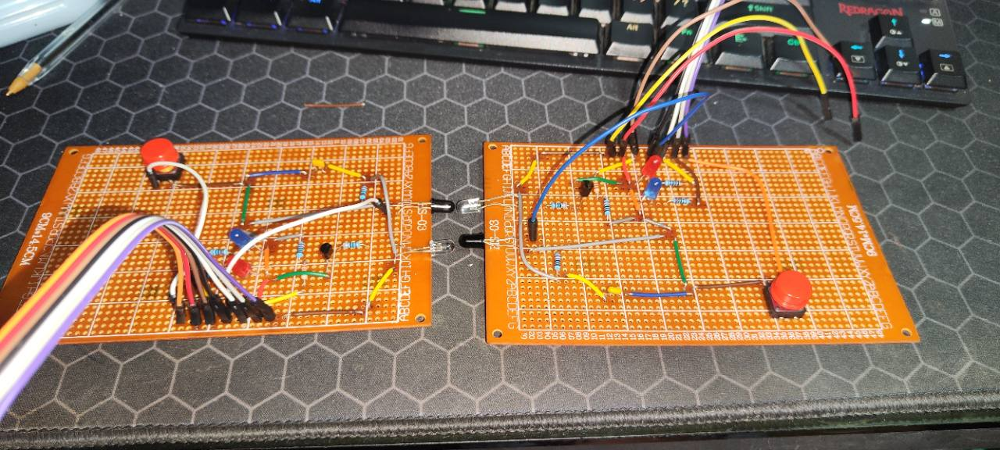
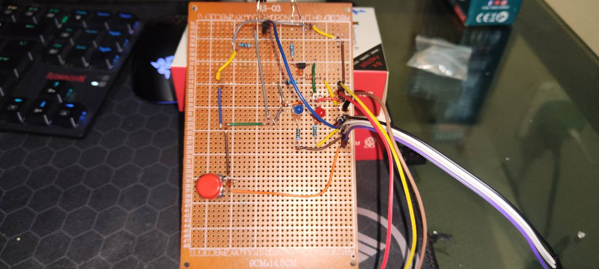
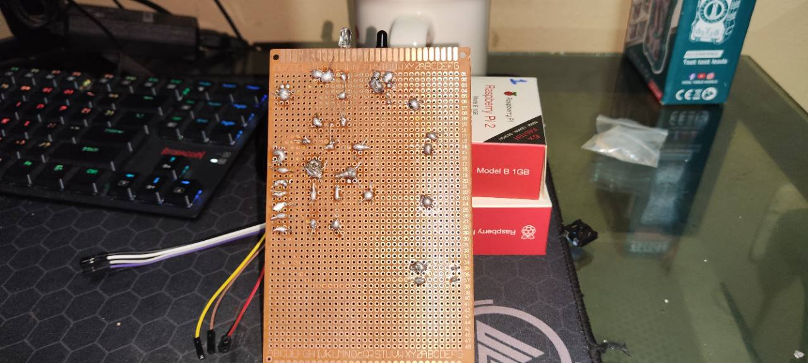
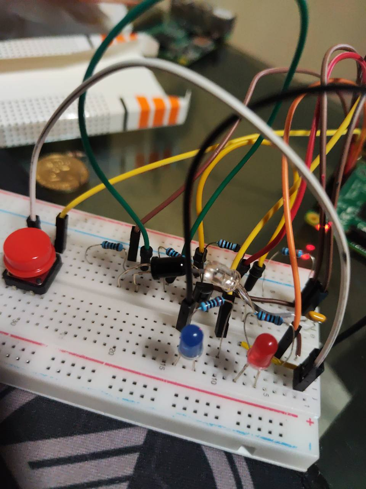
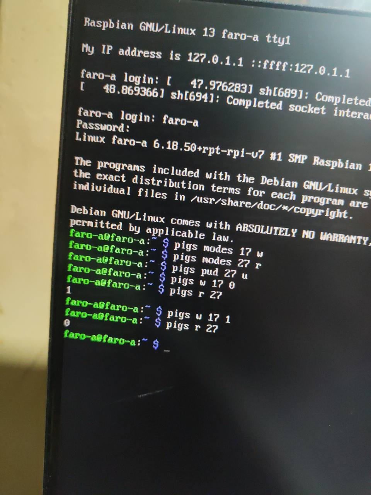

# Fotografías del montaje y las pruebas

Fotografías originales aportadas por Jimmy y Juan para el cierre del proyecto
del 1 de noviembre de 2026. Se conservan sin modificar los píxeles ni añadir
resultados a las pantallas. Los nombres identifican el contenido visible;
las tomas individuales no llevan una etiqueta física A/B.

| Archivo | Contenido documentado |
| --- | --- |
| [faros-conjunto-final.jpg](faros-conjunto-final.jpg) | Ambas placas perforadas terminadas, con componentes, botones, headers y pares IR enfrentados |
| [placa-componentes-final.jpg](placa-componentes-final.jpg) | Vista frontal individual: resistencias, transistor, indicadores, botón y cableado |
| [placa-soldaduras-final.jpg](placa-soldaduras-final.jpg) | Vista posterior individual: pads, uniones de estaño y alambres soldados |
| [prototipo-detalle-ir.jpg](prototipo-detalle-ir.jpg) | Configuración de desarrollo en MB102; PT333 negro, LED IR transparente, transistor y resistencias |
| [prueba-gpio-1-0.jpg](prueba-gpio-1-0.jpg) | Captura de pigpio: TX17=0 produce RX27=1; TX17=1 produce RX27=0 |
| [prototipo-a.jpg](prototipo-a.jpg) | Fotografía anterior de la protoboard, conservada como desarrollo |
| [faro-b-componentes.jpg](faro-b-componentes.jpg) | Fotografía anterior de una placa soldada, conservada como desarrollo |

## Montaje final

La [captura histórica de loopback](prueba-loopback-diagnostico.jpg) conserva
además el ensayo posterior de 0/5 tramas usado en la bitácora de diagnóstico.
Se identifica por separado de la captura 1/0 y del éxito reportado a 1000 baudios.

La fotografía conjunta muestra las caras de componentes de las dos unidades.
Las vistas frontal y posterior individuales documentan el detalle del montaje
fotografiado. La cara de soldadura se presenta con esa identificación, sin
duplicarla ni atribuirla a las dos unidades.

## Prototipo y lectura óptica

En la protoboard, el grupo reportó recepción completa de las tramas a 1000
baudios y un límite próximo a 1050. La captura adjunta documenta específicamente
la respuesta estática del detector: 1 sin emisión y 0 con emisión.
La lectura es lógica; los voltajes del informe son referencias calculadas.
