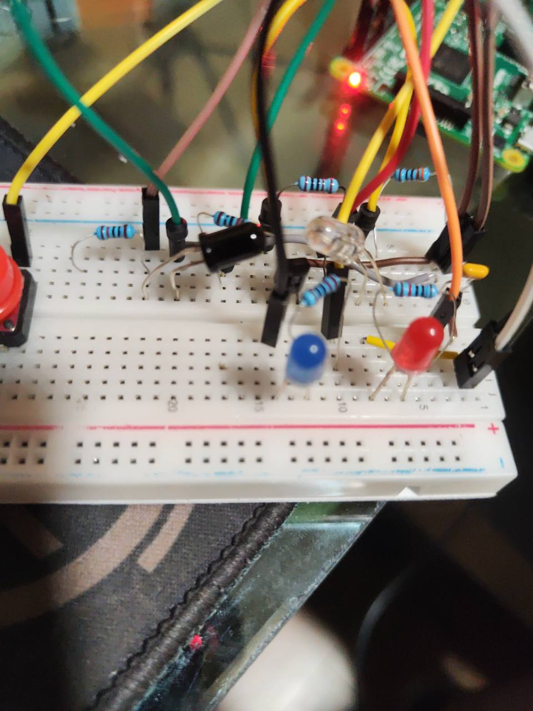
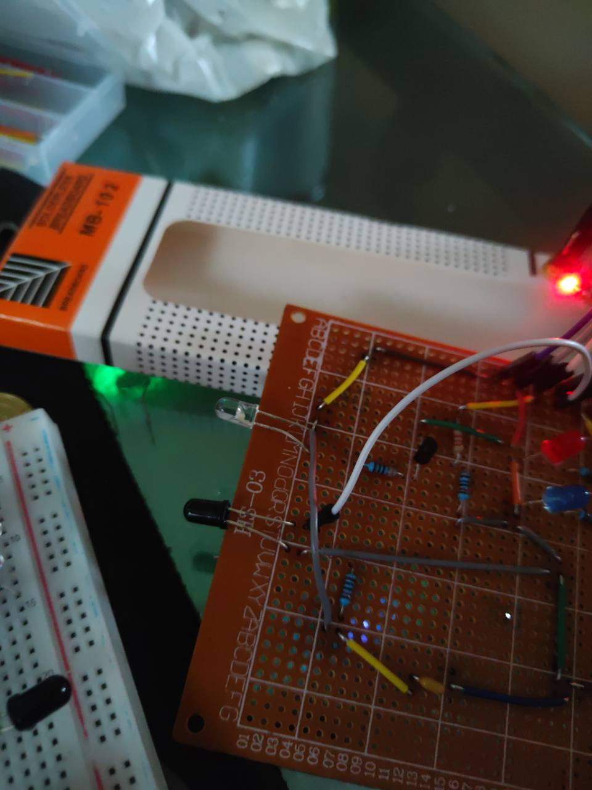

# Inventario de fotografías

Se conservan fotografías proporcionadas por el grupo sin retocarlas para simular
resultados. Las vistas de protoboard se identifican como desarrollo.

| Archivo o vista requerida | Contenido y estado |
| --- | --- |
| `prototipo-a.jpg` | Prototipo en MB102; evidencia de desarrollo, no placa final |
| `faro-b-componentes.jpg` | Placa soldada, lado de componentes; no verifica el cobre |
| Faro A, cara de componentes final | Pendiente recibir |
| Faro A, cara de cobre final | Pendiente recibir |
| Faro B, cara de cobre final | Pendiente recibir |
| Continuidad, VCC-GND y voltajes con multímetro | Pendiente recibir |

Para completar la entrega, fotografiar ambas caras de cada placa sin alimentación,
con etiquetas A/B y suficiente enfoque para distinguir soldaduras y puentes.
Las fotos de medición deben mostrar el punto y la lectura. Evitar capturar
contraseñas, llaves privadas o identificadores de usuarios.
